# Celebrare Photo Gallery Web App — Complete Project Documentation

This document provides a comprehensive technical overview, architectural deep-dive, implementation breakdown, and evaluation guide for the **Photo Gallery Web Application** built for the **Celebrare Frontend Internship Pre-Screening Assignment**.

---

## 📌 Table of Contents
1. [Project Overview & Objectives](#1-project-overview--objectives)
2. [Tech Stack & Constraint Adherence](#2-tech-stack--constraint-adherence)
3. [Architecture & Folder Structure](#3-architecture--folder-structure)
4. [Detailed Breakdown of Assignment Requirements](#4-detailed-breakdown-of-assignment-requirements)
   - [Requirement 1: Vite + React + Tailwind CSS Setup](#requirement-1-vite--react--tailwind-css-setup)
   - [Requirement 2: Data Fetching from API with Loading & Error States](#requirement-2-data-fetching-from-api-with-loading--error-states)
   - [Requirement 3: Responsive Grid Layout & Photo Card](#requirement-3-responsive-grid-layout--photo-card)
   - [Requirement 4: Real-Time Author Search Filter](#requirement-4-real-time-author-search-filter)
   - [Requirement 5: Favourites State with useReducer & LocalStorage](#requirement-5-favourites-state-with-usereducer--localstorage)
   - [Requirement 6: Custom Hook (`useFetchPhotos`)](#requirement-6-custom-hook-usefetchphotos)
   - [Requirement 7: Performance Optimizations (`useCallback` & `useMemo`)](#requirement-7-performance-optimizations-usecallback--usememo)
5. [Data Flow & State Lifecycle Diagram](#5-data-flow--state-lifecycle-diagram)
6. [Component-by-Component Documentation](#6-component-by-component-documentation)
7. [Key Technical Challenges & Solutions](#7-key-technical-challenges--solutions)
8. [Automated Verification & Browser Testing](#8-automated-verification--browser-testing)
9. [5-Minute Screen Recording Cheat Sheet](#9-5-minute-screen-recording-cheat-sheet)
10. [Local Setup & Deployment Instructions](#10-local-setup--deployment-instructions)

---

## 1. Project Overview & Objectives

The Celebrare Pre-Screening Assignment requires building a clean, responsive, high-performance Photo Gallery Web Application in React. The core goals are:
- Fetching 30 high-resolution photos on load from the Picsum Photos API.
- Providing a responsive card grid adapted for mobile, tablet, and desktop screens.
- Implementing instant, client-side author search without page reload or additional API requests.
- Managing persistent user favorites using `useReducer` and browser `localStorage`.
- Isolating data-fetching side effects inside a custom hook (`useFetchPhotos`).
- Guaranteeing high performance using memoization hooks (`useCallback`, `useMemo`, `React.memo`).
- Delivering clean, maintainable code following modern React patterns and zero external UI component libraries.

---

## 2. Tech Stack & Constraint Adherence

| Constraint / Tool | Choice | Justification & Verification |
|---|---|---|
| **Framework** | **React 19** (Functional components only) | Modern React with hooks; strictly zero class components used. |
| **Bundler & Tooling** | **Vite 8** | Instant Hot Module Replacement (HMR), sub-second build times, zero-overhead bundling. |
| **Styling** | **Tailwind CSS v3** + PostCSS | Pure utility-first CSS; zero UI libraries used (no Material-UI, Ant Design, or Bootstrap). |
| **Icons** | **Handcrafted SVG Icons** | Accessible, inline, scalable vector icons eliminating heavy third-party icon packages. |
| **Persistence** | **Browser `localStorage` API** | Synchronous client storage with safe JSON parsing and fallback error boundaries. |
| **API Provider** | **Picsum Photos API** | High-availability endpoint: `https://picsum.photos/v2/list?limit=30`. |

---

## 3. Architecture & Folder Structure

The project follows a modular, feature-oriented structure separating hooks, reducers, and presentational components:

```
Photo Gallery Web App/
├── public/
│   ├── favicon.svg             # Application favicon
│   └── icons.svg               # SVG asset definitions
├── src/
│   ├── assets/                 # Static media and logos
│   ├── components/             # Reusable, single-responsibility UI components
│   │   ├── EmptyState.jsx      # Fallback UI when author search produces 0 matches
│   │   ├── ErrorState.jsx      # Error banner with friendly message and retry action
│   │   ├── Gallery.jsx         # Core container coordinating data, state & grid
│   │   ├── Header.jsx          # App branding, title & live favourites count badge
│   │   ├── LoadingSpinner.jsx  # Pulse spinner rendered during network requests
│   │   ├── PhotoCard.jsx       # Individual photo card with image skeleton & heart button
│   │   └── SearchBar.jsx       # Controlled search input with real-time feedback
│   ├── hooks/
│   │   └── useFetchPhotos.js   # Custom hook encapsulating API fetch, abort controller & error states
│   ├── reducers/
│   │   └── favouritesReducer.js# Pure reducer for favourite IDs with localStorage synchronization
│   ├── App.jsx                 # Root layout component
│   ├── index.css               # Tailwind directives and custom animation utilities
│   └── main.jsx                # React DOM entry point
├── index.html                  # HTML5 boilerplate with Google Inter fonts & metadata
├── package.json                # Project dependencies and script scripts
├── postcss.config.js           # PostCSS configuration for Tailwind CSS
├── tailwind.config.js          # Tailwind theme configurations and content paths
├── vite.config.js              # Vite React plugin configuration
├── README.md                   # Quick-start guide and requirement map
├── RECORDING_SCRIPT.md         # Minute-by-minute cheat sheet for 5-minute video presentation
└── DOCUMENTATION.md            # This comprehensive document
```

---

## 4. Detailed Breakdown of Assignment Requirements

### Requirement 1: Vite + React + Tailwind CSS Setup
- **Scaffolding**: Created using Vite's modern React template.
- **Styling**: Tailwind CSS is installed with `@tailwindcss/postcss` and configured via `tailwind.config.js`.
- **Pure CSS Directives**: In `src/index.css`:
  ```css
  @tailwind base;
  @tailwind components;
  @tailwind utilities;
  ```
- **Constraint Compliance**: Zero component libraries (no MUI, AntD, or Bootstrap) were installed or imported. All components are 100% styled via Tailwind utility classes.

### Requirement 2: Data Fetching from API with Loading & Error States
- **Endpoint**: `https://picsum.photos/v2/list?limit=30`
- **Initial Load**: Data is requested on initial component mount.
- **Loading State**: While network request is pending, `loading === true`, displaying [`LoadingSpinner.jsx`](file:///c:/Users/mayan/Desktop/Photo%20Gallery%20Web%20App/src/components/LoadingSpinner.jsx) with a rotating indicator and skeleton animations.
- **Error Handling**: Network failures or non-200 HTTP responses are caught in a `try...catch` block. The UI displays [`ErrorState.jsx`](file:///c:/Users/mayan/Desktop/Photo%20Gallery%20Web%20App/src/components/ErrorState.jsx) with an informative alert and a **Try Again** button that triggers a retry via `refetch()`.

### Requirement 3: Responsive Grid Layout & Photo Card
The grid adjusts responsively according to standard breakpoints:
- **Desktop (>= 1024px)**: 4 columns (`lg:grid-cols-4`)
- **Tablet (>= 768px)**: 2 columns (`md:grid-cols-2`)
- **Mobile (< 768px)**: 1 column (`grid-cols-1`)
- **Card Elements in [`PhotoCard.jsx`](file:///c:/Users/mayan/Desktop/Photo%20Gallery%20Web%20App/src/components/PhotoCard.jsx)**:
  1. **Photograph**: Aspect ratio container (`aspect-[4/3]`) with subtle hover zoom effect (`group-hover:scale-105`), skeleton shimmer before image load, and fallback to full-size URL if thumbnail fails.
  2. **Author Name**: Photographer name styled cleanly in semibold slate typography with automatic text truncation.
  3. **Heart Icon Button**: Floating toggle button on top-right. Unfavourited = outlined stroke; Favourited = filled rose-500 color with a small badge. Fully accessible via `aria-label` attributes.

### Requirement 4: Real-Time Author Search Filter
- **Mechanism**: As the user types in [`SearchBar.jsx`](file:///c:/Users/mayan/Desktop/Photo%20Gallery%20Web%20App/src/components/SearchBar.jsx), state variable `searchQuery` updates immediately.
- **Client-Side Filtering**: Filters the 30 fetched photos client-side:
  ```javascript
  const filteredPhotos = useMemo(() => {
    if (!searchQuery.trim()) return photos;
    const normalizedQuery = searchQuery.toLowerCase().trim();
    return photos.filter((photo) =>
      photo.author.toLowerCase().includes(normalizedQuery)
    );
  }, [photos, searchQuery]);
  ```
- **Zero Page Reload & Zero Network Calls**: Searches run instantly against memory in < 1 millisecond.
- **Auxiliary Controls**:
  - Live result counter (e.g. `Showing 15 of 30 photos`).
  - Clear button (`✕`) to instantly reset input.
  - Dedicated [`EmptyState.jsx`](file:///c:/Users/mayan/Desktop/Photo%20Gallery%20Web%20App/src/components/EmptyState.jsx) with a "Reset Search" button when no authors match.

### Requirement 5: Favourites State with `useReducer` & `localStorage`
- **Constraint Check**: Managed strictly using `useReducer`—`useState` is **not** used for favourite items.
- **Persistence Mechanism**:
  1. **Lazy Initialization (`initFavourites`)**:
     Passed as the 3rd argument to `useReducer`. It reads from `localStorage` once on mount:
     ```javascript
     export function initFavourites() {
       try {
         const saved = localStorage.getItem('photo_gallery_favourites');
         return saved ? JSON.parse(saved) : [];
       } catch (error) {
         console.error('Failed to parse favourites from localStorage:', error);
         return [];
       }
     }
     ```
  2. **Action Handling**:
     ```javascript
     case FAVOURITES_ACTIONS.TOGGLE_FAVOURITE: {
       const photoId = action.payload;
       const isAlreadyFavourite = state.includes(photoId);
       const updatedState = isAlreadyFavourite
         ? state.filter((id) => id !== photoId)
         : [...state, photoId];
       localStorage.setItem(STORAGE_KEY, JSON.stringify(updatedState));
       return updatedState;
     }
     ```
- **Reload Verification**: Reloading the browser preserves favourited status, active heart states, and header badge counters.

### Requirement 6: Custom Hook (`useFetchPhotos`)
- Located in [`src/hooks/useFetchPhotos.js`](file:///c:/Users/mayan/Desktop/Photo%20Gallery%20Web%20App/src/hooks/useFetchPhotos.js).
- **Interface**: Returns `{ photos, loading, error, refetch }`.
- **Decoupling**: The [`Gallery.jsx`](file:///c:/Users/mayan/Desktop/Photo%20Gallery%20Web%20App/src/components/Gallery.jsx) component never invokes `fetch` directly; it relies completely on this custom hook.
- **Memory Safety**: Uses `AbortController` in `useEffect` cleanup so that unmounting during an in-flight network request cleanly cancels the request and avoids setting state on an unmounted component.

### Requirement 7: Performance Optimizations (`useCallback` & `useMemo`)
1. **`useCallback` for Event Handlers**:
   - `handleSearchChange`: Memoizes the input handler reference. When other state (like favourites) changes, `SearchBar` does not re-render because its prop reference remains stable.
   - `handleToggleFavourite`: Memoizes the dispatch trigger passed down to cards.
2. **`useMemo` for Filtered Photos**:
   - Computes `filteredPhotos` only when `photos` or `searchQuery` changes.
   - When a user marks or unmarks a favourite photo, `favourites` state updates, but `filteredPhotos` does **not** re-filter the array because `[photos, searchQuery]` dependencies remain untouched.
3. **`React.memo` on `PhotoCard`**:
   - Each card is wrapped in `React.memo`. When one card's favourite status changes, only that specific card re-renders; the other 29 cards skip re-rendering entirely.

---

## 5. Data Flow & State Lifecycle Diagram

The following diagram illustrates how user interactions flow through hooks, reducers, and components:

```mermaid
flowchart TD
    subgraph InitialMount [1. App Mounting & Initialization]
        A[Gallery Component Mounts] --> B[useFetchPhotos Hook Triggered]
        A --> C[initFavourites reads localStorage]
        C --> D[useReducer State Initialized with Saved IDs]
        B --> E[Fetch Picsum API limit=30]
        E -->|Success| F[Set photos: 30 items, loading: false]
        E -->|Failure| G[Set error message, loading: false]
    end

    subgraph UserSearch [2. Real-Time Search Workflow]
        H[User Types in SearchBar] --> I[handleSearchChange memoized via useCallback]
        I --> J[searchQuery state updated]
        J --> K[useMemo re-computes filteredPhotos]
        K --> L[Gallery re-renders with matching cards]
    end

    subgraph FavouritesWorkflow [3. Favourites Toggle & Persistence]
        M[User Clicks Heart on PhotoCard] --> N[handleToggleFavourite memoized via useCallback]
        N --> O[Dispatch TOGGLE_FAVOURITE action]
        O --> P[favouritesReducer computes new array]
        P --> Q[Synchronize JSON array to localStorage]
        P --> R[useReducer updates favourites state]
        R --> S[Only affected PhotoCard re-renders via React.memo]
        R --> T[Header counter badge updates]
    end
```



---

## 6. Component-by-Component Documentation

### `src/App.jsx`
- **Role**: Root container providing semantic `<header>`, `<main>`, and `<footer>` layouts.
- **State**: Tracks total favourites count to display on the sticky top header.

### `src/components/Header.jsx`
- **Role**: Displays the branding title, subtitle, and an interactive pill badge displaying the live count of favourited photos.

### `src/components/SearchBar.jsx`
- **Role**: Search input bar with search icon, clear button (`✕`), and live count badge showing filtered vs total items (e.g. `15 / 30 photos`).
- **Optimization**: Fully controlled component with memoized callback.

### `src/components/Gallery.jsx`
- **Role**: The orchestrator component.
- **Responsibilities**:
  - Consumes `useFetchPhotos()`.
  - Instantiates `useReducer(favouritesReducer, [], initFavourites)`.
  - Manages `searchQuery` state.
  - Implements `useCallback` for search and favourite triggers.
  - Implements `useMemo` for filtered list calculation.
  - Conditionally renders `LoadingSpinner`, `ErrorState`, `EmptyState`, or the responsive grid of `PhotoCard`s.

### `src/components/PhotoCard.jsx`
- **Role**: Presentation of photo thumbnail, photographer metadata, and heart toggle button.
- **Key Features**:
  - Image skeleton pulse placeholder while image downloads.
  - Fallback error handler for image assets.
  - Dynamic heart button styling (outline vs filled rose red).
  - Wrapped in `React.memo(PhotoCard)`.

### `src/components/LoadingSpinner.jsx`
- **Role**: Centered loading spinner with subtle animated gradient and accessibility notice.

### `src/components/ErrorState.jsx`
- **Role**: Error state card with warning icon, error description, and a retry button that invokes `refetch()`.

### `src/components/EmptyState.jsx`
- **Role**: Zero-results fallback displaying the searched query and a button to reset the search.

---

## 7. Key Technical Challenges & Solutions

### Challenge 1: Clean LocalStorage Sync without Hydration Glitches
- **Issue**: Reading `localStorage` synchronously inside component bodies causes performance lag on every re-render. If stored data is corrupted, standard `JSON.parse` crashes the whole app.
- **Solution**: Implemented a **lazy initializer function** `initFavourites()` as the third parameter of `useReducer`. It only executes once during initial component mount. Wrapped with `try...catch` and an empty array `[]` fallback.

### Challenge 2: Network Resiliency & In-Flight Request Cleanup
- **Issue**: Fast unmounting or multiple re-fetches could cause race conditions or memory leak warnings in React ("Cannot update unmounted component").
- **Solution**: Integrated native browser `AbortController` inside `useFetchPhotos`. If the component unmounts while the request is in-flight, `controller.abort()` cleanly discards the response, ignoring `AbortError`.

### Challenge 3: Eliminating Unnecessary Re-Renders
- **Issue**: In a list of 30 cards, toggling a single heart icon causes parent state to update, which by default re-evaluates all 30 cards and re-runs the search filtering loop.
- **Solution**:
  - Wrapped `PhotoCard` in `React.memo`.
  - Wrapped `handleSearchChange` in `useCallback`.
  - Wrapped `filteredPhotos` in `useMemo` keyed exclusively to `[photos, searchQuery]`. Result: toggling favourites causes **zero** re-filtering calculations and only **one** card re-render.

---

## 8. Automated Verification & Browser Testing

The application was verified in an automated headless browser environment across all functional requirements:

| Test Scenario | Action Tested | Expected Outcome | Verification Result |
|---|---|---|:---:|
| **1. Initial Load** | Open `http://localhost:5173/` | 30 photos fetched, 4-column desktop grid rendered | ✅ Passed |
| **2. Search Filtering** | Typed `"Alejandro"` into search | 15 photos displayed in real-time, no page reload | ✅ Passed |
| **3. Search Reset** | Clicked clear button `✕` | Input cleared, all 30 photos restored instantly | ✅ Passed |
| **4. Favourites Toggle** | Clicked heart on photo 1 & 2 | Heart turns red, badges visible, header counter reads `2` | ✅ Passed |
| **5. Storage Persistence**| Refreshed the page (`F5`) | Favourites and counter remain `2` after reload | ✅ Passed |
| **6. Console Inspection** | Checked browser console logs | Zero errors, zero warnings | ✅ Passed |
| **7. Production Build** | Executed `npm run build` | Built in < 1 second with clean bundle output | ✅ Passed |

A full WebP recording of the automated verification test is archived at:
[`gallery_verification.webp`](file:///C:/Users/mayan/.gemini/antigravity-ide/brain/dae8659c-0957-4d5e-a7cf-288efb95ca49/gallery_verification_1792764518786.webp)

---

## 9. 5-Minute Screen Recording Cheat Sheet

Use this guide during your required video presentation:

| Time | Segment | What to Show | Key Talking Points |
|---|---|---|---|
| **0:00 - 1:15** | **Live App Demo** | Browser (`http://localhost:5173`) | Show initial 30 photos, 4-column grid, search for `"Alejandro"` (real-time filter), toggle 2 favourites, refresh page to show persistence. |
| **1:15 - 2:00** | **`useFetchPhotos` Hook** | `src/hooks/useFetchPhotos.js` | Explain return values: `{ photos, loading, error, refetch }`. Explain `try...catch` and `AbortController` error handling. |
| **2:00 - 3:00** | **`useReducer` Code** | `src/reducers/favouritesReducer.js` | Explain `TOGGLE_FAVOURITE` action. Explain why `useReducer` was chosen over `useState` (separation of concerns, centralized persistence, testability). |
| **3:00 - 4:00** | **`useCallback` & `useMemo`** | `src/components/Gallery.jsx` | Explain how `useCallback` preserves handler reference equality and `useMemo` prevents running `.filter()` during favourites toggling. |
| **4:00 - 4:45** | **The Difficult Part** | `src/reducers/favouritesReducer.js` | Discuss handling `localStorage` safely via a lazy initializer (`initFavourites`) to avoid initial mount lag and JSON parse crashes. |
| **4:45 - 5:00** | **Wrap Up** | Browser | Quick concluding remark and thank you. |

---

## 10. Local Setup & Deployment Instructions

### Prerequisites
- Node.js (v18.0 or higher)
- npm (v9.0 or higher)

### Quick Start
```bash
# 1. Clone repository or navigate to directory
cd "Photo Gallery Web App"

# 2. Install dependencies
npm install

# 3. Start local development server
npm run dev
```
Open [http://localhost:5173](http://localhost:5173) in your browser.

### Production Build
```bash
# Generate optimized production bundle
npm run build

# Preview production build locally
npm run preview
```

### Git Repository Initialization
The Git repository is already initialized with an initial commit:
```bash
git remote add origin https://github.com/<your-username>/<your-repo-name>.git
git branch -M main
git push -u origin main
```
